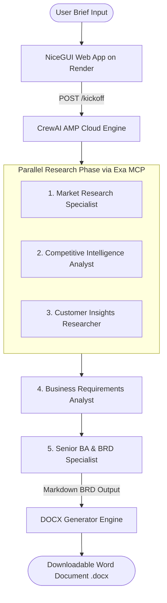

# Market Research & BRD Generator

An autonomous multi-agent platform that takes any startup or business idea and performs complete market research, competitor intelligence, customer analysis, and generates a ready-to-use Business Requirements Document (BRD) exported as an editable Word document (.docx).

**Live:** [https://market-research-agent-crewai.onrender.com](https://market-research-agent-crewai.onrender.com)

---

## Why I Built This

Drafting a proper Business Requirements Document (BRD) takes hours of manual work:
- Researching market size and industry trends
- Finding direct and indirect competitors, their features and pricing
- Understanding customer pain points
- Converting all that research into structured, testable functional and non-functional requirements

AI chatbots usually hallucinate figures/citations or give generic bullet points. I built this project to solve that by using **a crew of 5 specialized agents** with strict research limits and evidence-based reporting.

---

## Architecture & How It Works

The project is split into two parts:
1. **Frontend (Deployed on Render):** A clean Python web app built with NiceGUI. It handles user inputs, polls agent progress and builds the downloadable `.docx` file.
2. **Multi-Agent Engine (CrewAI AMP):** Runs the 5-agent crew. Also connected to AMP dashboard for tracing and monitoring.



---

## The 5 Specialized Agents

1. **Market Research Specialist**
   - Conducts focused market sizing using live Exa web searches.
   - Identifies industry trends, regulatory considerations and growth drivers.

2. **Competitive Intelligence Analyst**
   - Discovers direct and indirect competitors.
   - Evaluates competitor offerings, pricing models and market positioning gaps.

3. **Customer Insights Researcher**
   - Researches target customer segments, pain points and current alternatives.
   - Analyzes adoption barriers and willingness to pay based on public customer feedback.

4. **Business Requirements Analyst**
   - Synthesizes findings from the first 3 research reports with the user's initial brief.
   - Breaks requirements into Functional (`BRD-F`) and Non-Functional (`BRD-NF`) with priority ratings (Must/Should/Could Have).

5. **Senior Business Analyst & BRD Specialist**
   - Compiles everything into a formal 8-section Business Requirements Document.
   - Includes Document Control, Scope boundaries, Traceability Matrix and Sign-off criteria.

---

## Tech Stack

- **Agent Orchestration:** CrewAI 
- **Live Search:** Exa AI via Model Context Protocol (MCP)
- **LLM:** OpenRouter (model = `baidu/ernie-5.5-flash-preview:free`)
- **Frontend:** NiceGUI 
- **Document Generation:** python-docx 
- **Package Management:** uv
- **Deployment:** Render

---

## Key Features

- **Parallel Research:** The first 3 research tasks run simultaneously to keep generation time between 2 to 3 minutes.
- **Evidence-Based Outputs:** Prompts strictly instruct agents to distinguish verified facts from assumptions and include source URLs.
- **Editable Word Export:** The app formats the output into a styled Word document with custom tables and typography.
- **One-Click Example:** Includes a "Try Example Prompt" button so anyone testing the site can run a pre-filled business scenario instantly.

---

## Local Setup

### Prerequisites
- Python 3.10 to 3.13
- [uv](https://docs.astral.sh/uv/) installed

### Steps

1. Clone the repository:
   ```bash
   git clone https://github.com/Kashish415/Market-Research-BRD-Generator.git
   cd Market-Research-BRD-Generator
   ```

2. Install dependencies:
   ```bash
   uv sync
   ```

3. Create a `.env` file in the root directory:
   ```env
   OPENROUTER_API_KEY=your_openrouter_api_key
   AMP_API_URL=your_crewai_amp_url
   AMP_BEARER_TOKEN=your_amp_bearer_token
   ```

4. Run the web UI:
   ```bash
   uv run python -m market_research_agent.app
   ```

5. Open your browser at `http://localhost:8080`.

---

## Limitations & Future Scope

### Limitations
- **Generation Time:** Real-time web crawling and synthesis across 5 agents takes about 2 to 3 minutes per run.
- **Model Quota:** Currently configured with free OpenRouter models for demonstration, which have public rate limits.

### Future Scope
- **Asynchronous Email Delivery via MCP:** Since deep market research takes 2-3 minutes, the next big step can be to integrate an Email MCP server to automatically mail the generated BRD report to the user upon completion.

- **Model Upgrades:** Support higher-tier reasoning models (e.g., Claude 3.5 Sonnet / GPT-4o) for deeper quantitative and qualitative research.